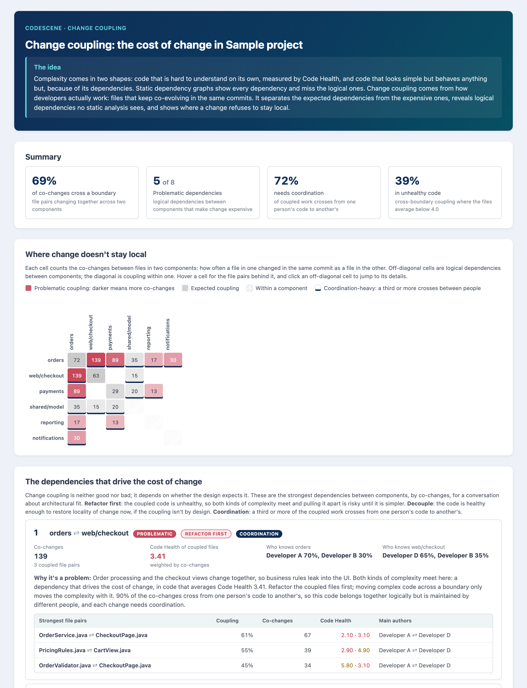
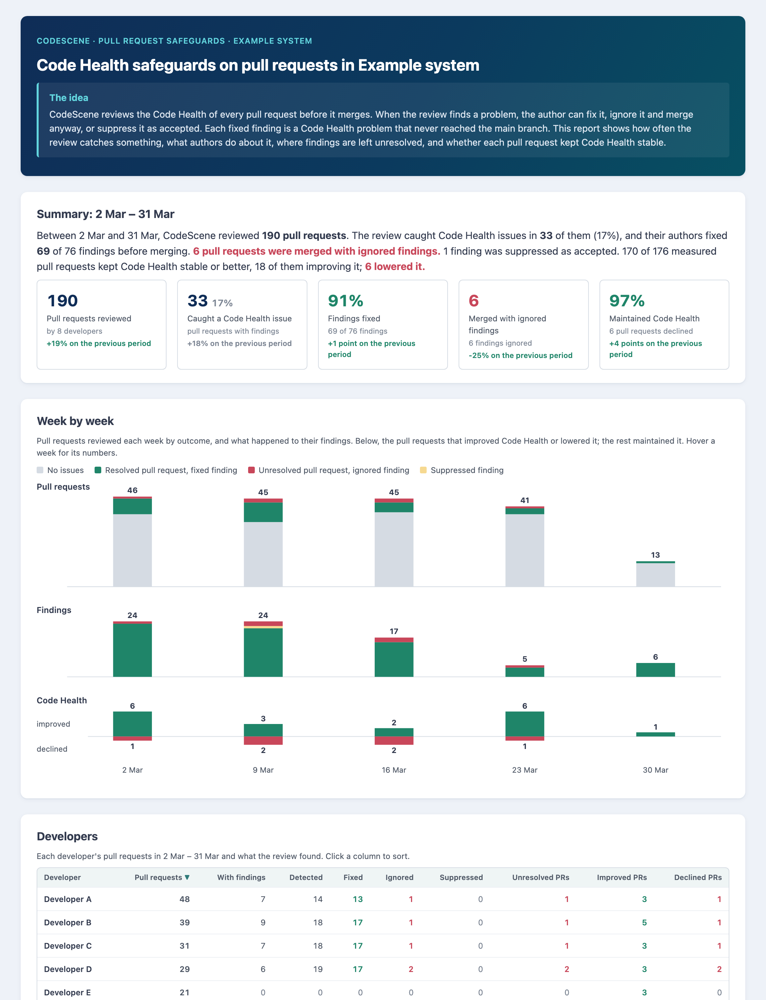
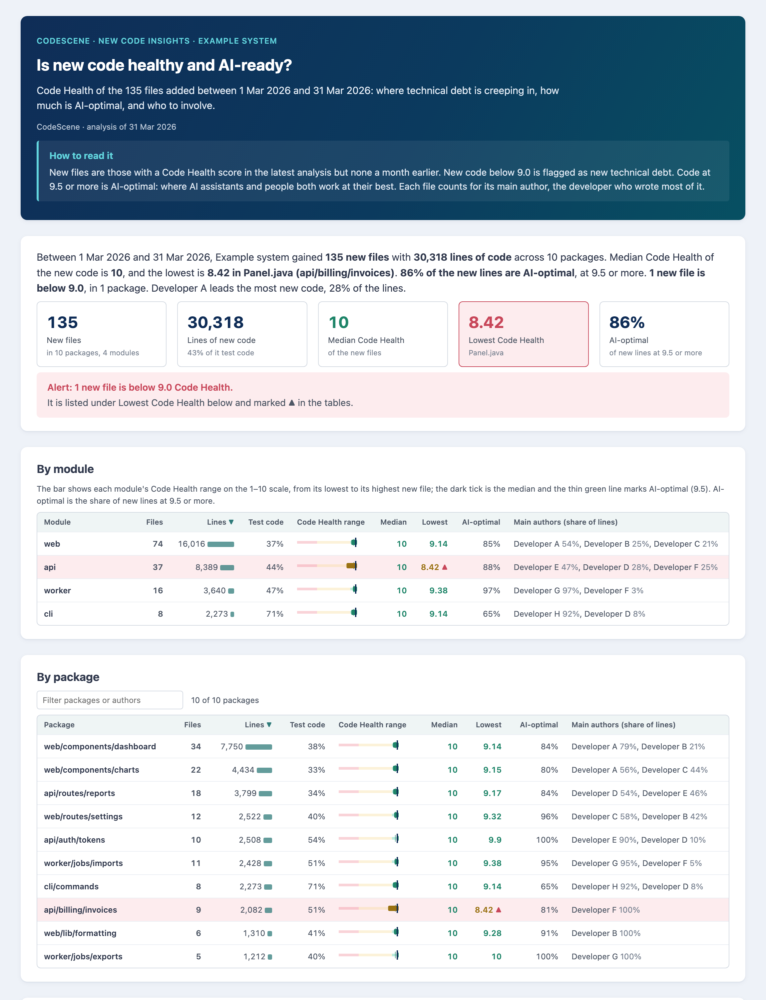
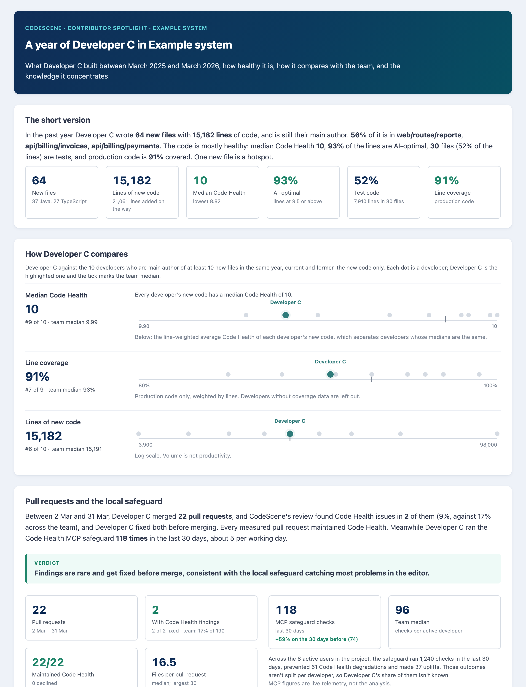

# CodeScene intelligence library

Reusable skills and report templates that turn CodeScene's analysis into reports, through the CodeScene MCP server. Clients fetch them as they are, or copy and adapt them into their own.

Everything here is generic: no project names, people or analysis numbers. Project-specific inputs and decisions live in the client's own workspace, created from each skill's `templates/`.

## Skills

| Skill | Summary |
|---|---|
| [architectural-hotspots](skills/architectural-hotspots/SKILL.md) | Components in PAID quadrants by change activity and Code Health, with outcomes and team ROI for uplifting the ones to address first. [Details](#architectural-hotspots) |
| [refactoring-targets](skills/refactoring-targets/SKILL.md) | CodeScene's uplift targets as a prioritized refactoring backlog for an engineering manager: why each file, where to start, who to involve, the risks to plan for and the estimated outcome, plus a refactoring spec per primary and secondary target to hand to a coding agent. [Details](#refactoring-targets) |
| [key-person-risk](skills/key-person-risk/SKILL.md) | The project's truck factor and what leaves with each key person: CodeScene's off-boarding risks, the uplift targets that depend on one person, and the Code Health and coverage of that code. [Details](#key-person-risk) |
| [change-coupling](skills/change-coupling/SKILL.md) | The cost of change for software architects: logical dependencies between components mined from change coupling, the coordination they force between people, and how hard each is to break given the Code Health of the coupled code. [Details](#architecture-change-coupling) |
| [portfolio-overview](skills/portfolio-overview/SKILL.md) | A one-page summary of every project you can access, for technical leaders and managers: what works well, where attention is needed, and how much of the code is AI-optimal, by hotspot Code Health. [Details](#portfolio-overview) |
| [mcp-safeguard-insights](skills/mcp-safeguard-insights/SKILL.md) | How a project's developers use the local Code Health MCP: safeguard checks, degradations prevented before commit, uplifts, the trend over a year, the most active users and out-of-date installations. [Details](#mcp-safeguard-insights) |
| [pull-request-safeguards](skills/pull-request-safeguards/SKILL.md) | How Code Health safeguards work on pull requests: how often the review catches an issue, how many findings authors fix rather than ignore or suppress, whether each pull request maintained Code Health, week by week, per developer and per pull request. [Details](#pull-request-safeguards) |
| [new-code-insights](skills/new-code-insights/SKILL.md) | Whether the code added over the last month is healthy and AI-ready: new code per module and package, its median and lowest Code Health, an alert for new technical debt, the share that is AI-optimal, and who to involve. [Details](#new-code-insights) |
| [contributor-spotlight](skills/contributor-spotlight/SKILL.md) | What one contributor built over the past year: how healthy, AI-optimal and well-tested it is, how it compares with the team on Code Health, coverage and volume, their recent pull requests and Code Health MCP use, and the knowledge they hold. [Details](#contributor-spotlight) |

## Use it in Kiro

The [CodeScene intelligence power for Kiro](kiro/codescene-intelligence/README.md) connects Kiro to the CodeScene MCP server and runs these reports. In Kiro's Powers panel, choose **Add Custom Power**, then **Import power from GitHub**, and paste `https://github.com/codescene-oss/codescene-intelligence-library/tree/main/kiro/codescene-intelligence`.

## Adding a skill

Each skill is a folder with the same layout:

```
catalog.json                     index of all skills; what clients fetch first
shared/                          rules and docs every skill follows
skills/<id>/
  SKILL.md                       the workflow: which MCP tools to call and how to read their results
  skill.json                     metadata: version, MCP tools used, inputs, renderers
  report-data.schema.json        the report's data contract, independent of any renderer
  renderers/                     self-contained HTML + SVG reports with a {{REPORT_DATA}} block
  templates/                     placeholder files for project-specific notes
  examples/                      sample report data for trying the renderer
```

1. Create `skills/<id>/` with the files above. List every MCP tool the skill calls in `skill.json`.
2. Keep project specifics out: use `{{placeholders}}` in templates and the `{{REPORT_DATA}}` block in renderers.
3. Add the skill to the table above and the details below, and run `python scripts/validate.py --fix` to add it to `catalog.json`.

See [CONTRIBUTING.md](CONTRIBUTING.md) for the contribution rules and how to run the checks locally.

## Releases

Each [GitHub release](https://github.com/codescene-oss/codescene-intelligence-library/releases) has a `codescene-intelligence-library-<version>.zip` with what clients need: `catalog.json`, `LICENSE`, `shared/` and `skills/`. Its `MANIFEST.json` lists the sha256 of every file, and the release carries the zip's checksum. Check a download for corruption with:

```bash
shasum -a 256 -c codescene-intelligence-library-<version>.zip.sha256
```

The checksum sits next to the zip, so it can't prove where the zip came from. Clients that sync a release should pin the zip's sha256 next to the version they pin.

## Skill details

### Architectural hotspots

Shows where in the architecture technical debt costs the most, and what paying it down would buy.


The report is a single HTML file with no dependencies, so it opens in any browser and prints to PDF. It contains:

- **A quadrant chart** of the architectural components. The horizontal axis is change activity, the vertical axis is Code Health, and bubble size is lines of code. Components that would overlap within a quadrant merge into a numbered group; hover to list them, click to spread them out.
- **An Address-first table** with each component's Code Health, trend, hotspots and worst file.
- **Estimated outcomes** of uplifting the Address components: fewer defects, less development time, higher productivity, and the hours a team would get back.

#### The PAID model

PAID is Gartner's model for prioritizing technical debt. It places each item on two axes, business impact and risk, and sorts it into one of four quadrants:

| Quadrant | Impact | Risk | Action |
|---|---|---|---|
| **Plan** | High | Low | Maintain; guard it so debt doesn't creep in |
| **Address** | High | High | Fix now; this debt taxes most of the delivery work |
| **Ignore** | Low | Low | No action |
| **Delay** | Low | High | Real debt, but cheap to carry; revisit if work shifts there |

The report measures both axes with CodeScene data. Impact is change activity: how much of the team's development runs through a component. Risk is low Code Health. Change activity follows a power law, so the split between busy and quiet uses head/tail breaks, cutting at the mean; the split between healthy and unhealthy is Code Health 9.0. The result separates the debt worth paying down from the debt that can safely wait.

### Refactoring targets

Turns CodeScene's uplift targets into a refactoring backlog that an engineering manager can plan from.


Uplift targets are unhealthy files that the team changes often, so refactoring them pays back in everyday delivery. CodeScene picks **primary** and **secondary** targets across the whole project, and **local** targets within each architectural component. The report keeps that order and, within each type, puts the most-changed file first. It contains:

- **A summary** of how many targets there are, how often the team changes them, their size, and how many need extra planning.
- **A backlog table** with one row per target: Code Health, commits, size, main author and the risks to plan for.
- **A card per target** with the evidence: the functions to start with, the Code Health issues, the files that change together with it, its Code Health trend, and the estimated outcome of refactoring it.
- **Who to involve:** the targets grouped by main author, flagging authors who are no longer active.
- **A refactoring spec** for each primary and secondary target, behind a *Refactoring spec* button. It's a Markdown brief for a coding agent: the goal, the functions to refactor in CodeScene's priority order with their evidence and CodeScene's guidance per Code Health issue, what to check first, constraints, and when the work is done. Copy it or download it as a `.md` file. The spec also tells the agent to refresh the data with the CodeScene MCP server, propose a plan for approval, and check Code Health after every step.

The risks are derived from the data. *Declining* means Code Health is getting worse, so the cost grows the longer it waits. *Knowledge risk* means most of the code would leave with its main author or already has. *Needs tests first* means line coverage is low or unknown, so add tests before refactoring.

### Key person risk

Answers a simple question in truck factor terms: what leaves when someone leaves?


The truck factor is the smallest number of people who could leave before a large part of the code has no one who knows it. Knowledge concentrated in one person matters most where the code is also hard to learn (low Code Health), unsafe to change (low test coverage) and needed often. The report therefore stays with CodeScene's off-boarding risks and uplift targets. It contains:

- **The project's truck factor:** an estimate from CodeScene's main-author data, naming the people it depends on.
- **What leaves with each person:** one bar per person, one block per file they mainly know, sized by commits. Off-boarding risks stand out in red, labelled with how much knowledge would remain; everything else is muted.
- **A card per off-boarding risk:** who holds the knowledge, how much would remain if they left, Code Health now and a year ago, coverage, and a concrete action, such as adding tests, then refactoring together with the next contributor.
- **People:** a sortable table of off-boarding risks, truck factor 1 files, and the Code Health and coverage of the code each person mainly knows.
- **Components** led by one person or holding off-boarding risks, and **knowledge already lost** to former contributors.

### Architecture: Change coupling

Shows the cost of change: where a change refuses to stay local, and what it takes to fix that.



Complexity comes in two shapes: code that is hard to understand on its own, which Code Health measures, and code that looks simple but behaves anything but because of its dependencies. Static dependency graphs list every dependency and miss the logical ones. Change coupling comes from developer behaviour instead: files that keep co-evolving in the same commits. The report lifts CodeScene's file-level change coupling to the architecture. It contains:

- **A component matrix** of co-changes. Problematic dependencies between components stand out in red; expected ones stay muted. The agent running the skill judges which is which from the architecture, and gives a reason for each.
- **A card per problematic dependency** with its co-changes, the Code Health of the coupled files, who knows each side, a verdict and a decoupling plan to hand to a coding agent. The verdict is *Refactor first* where both kinds of complexity meet, *Decouple* where the code is healthy enough to restore locality of change.
- **Coordination:** pairs of people whose code changes together, from each file's knowledge distribution. Code that logically belongs together but is maintained by different people; Conway's law, measured.

Change coupling is neither good nor bad, so the report separates the expected from the expensive: tests that co-evolve with their code are left out, and files outside any architectural component are left out with a footnote saying how much.

### Portfolio overview

Answers two questions a technical leader asks across all projects: what works well, and where is my attention needed?


Hotspots are the code the teams change most, so their Code Health decides how fast and safely a project delivers. The report places every project in one tier by hotspot Code Health:

| Tier | Hotspot Code Health |
|---|---|
| **Call to action** | below 4.0 |
| **Needs attention** | 4.0 to below 9.0 |
| **Healthy** | 9.0 to below 9.5 |
| **AI-optimal** | 9.5 and up: where AI assistants and people both work at their best, and a common goal |

It contains:

- **A summary** with the projects per tier and the share of all code that sits in AI-optimal projects.
- **A chart** of every project's hotspot Code Health, now and a year ago, over the four tier bands.
- **Where your attention is needed:** a card per project below 9.0, calls to action first, with its flags and a next step that points to the deeper report: *Refactoring targets*, *Architectural hotspots* or *Key person risk*. A **watch list** adds healthy projects with warning signs.
- **What works well:** the AI-optimal and healthy projects, and how far each healthy one is from 9.5.
- **All projects** in a sortable table, and the projects without Code Health data.

Flags never change a tier; they rank projects within one. They cover a twelve-month decline or improvement, uplift targets, unhealthy hotspots, off-boarding risks, Code Health alerts and dormant projects.

### MCP safeguard insights

Shows what the local Code Health MCP does for a project: how often developers and their AI assistants check Code Health while they code, and what those checks catch.


The data is live product telemetry, so it reflects use as of the moment the report is built, not the latest analysis. The report contains:

- **A summary** of the last week or month against the one before: active users, degradations prevented before commit and Code Health uplifts.
- **The year at a glance:** active users and impact per period.
- **The most active users**, by safeguard checks, with each person's previous period, who is new and who stopped. Names only: the report never shows email addresses.
- **How much each developer uses it**, as a distribution, and **which MCP tools** the checks come from.
- **Installations** per version, so outdated ones stand out, and **totals**: safeguard checks and all-time figures.

### Pull request safeguards

Shows whether CodeScene's Code Health review of pull requests keeps problems out of the main branch.



Every pull request gets a Code Health review before it merges. When the review finds a problem, the author can fix it, ignore it and merge anyway, or suppress it as accepted. The report is built from `get_pull_request_safeguard_outcomes`, one row per pull request. It contains:

- **A summary:** pull requests reviewed, how many had findings, the share of findings fixed, pull requests merged with ignored findings, and the share that maintained Code Health, each compared with the period before.
- **Week by week:** pull requests by outcome, what happened to their findings, and the pull requests that improved or lowered Code Health.
- **Developers:** a sortable table of each person's pull requests, their findings detected, fixed, ignored and suppressed, and their pull requests that improved or lowered Code Health. Aliases of one person are merged, and bots are listed apart.
- **Pull requests to look at:** only those merged with findings left in the code, ignored or suppressed, with the files changed, reviews, Code Health impact and lowest file touched. Plus a table per repository when there are several.

A pull request **maintained** Code Health when its change is inside a small stable band, 0.05 by default; only larger changes are called out as **improved** or **declined**. The report never shows the change as a decimal trend.

### New code insights

Answers "is new code healthy and AI-ready?" for the code added to a project over the last month: whether it adds technical debt, which is cheapest to prevent while the code is new, and whether it is AI-optimal, the Code Health where AI assistants and people both work at their best.



A file counts as new when it has a Code Health score in the latest analysis but none in CodeScene's snapshot a month earlier. The report is built from `explore_project_files`. It contains:

- **A summary:** new files and lines of code, the share that is test code, the median and lowest Code Health of the new files, the share of new lines that is AI-optimal (9.5 or more), and an alert when any new file is below 9.0.
- **By module and by package:** files, lines, the Code Health range with its median and lowest value, the AI-optimal share, and the main authors with their share of the lines. The package table shows the top 20 by default and has a filter.
- **Developer contributions:** each developer's new files and lines, their Code Health and AI-optimal share: where new knowledge sits and who to involve. Developers with new code below AI-optimal stand out. Also capped at 20 by default, with a filter.
- **Line coverage, when the project has it:** per module, package and developer, and the least covered new files. Coverage is an optional integration, so the report leaves it out when there is none.
- **Lowest Code Health:** the new files below 10, lowest first.

The row limits, the alert threshold, the AI-optimal level and the coverage target are inputs of the skill.

### Contributor spotlight

A year in review for one person: what they built, how healthy it is, and how it compares with the rest of the team. It celebrates and explains a contribution; it is not a performance review.



A file counts as the contributor's when they are its main author and it has no Code Health score in CodeScene's snapshot a year before the latest analysis. The report is built from `explore_project_files`, plus `get_pull_request_safeguard_outcomes` and `get_mcp_safeguard_insights` when they have data. It contains:

- **A summary:** new files and lines, median and lowest Code Health, the share that is AI-optimal, test code and line coverage.
- **How they compare:** median Code Health, coverage and lines of new code against every developer with at least 10 new files, as a strip of unnamed dots with the contributor highlighted.
- **Pull requests and the local safeguard:** recent pull requests and what the review found, Code Health MCP safeguard checks, and a one-line verdict.
- **What they built:** new code by area, and the signature files they put the most lines into.
- **The knowledge they hold:** every file they are main author of, how much only they have touched, and who else knows it; for a former contributor, the knowledge they leave.

The benchmark minimum, the AI-optimal level and the stable band for pull requests are inputs of the skill.

## License

Licensed under the [Apache License 2.0](LICENSE).
